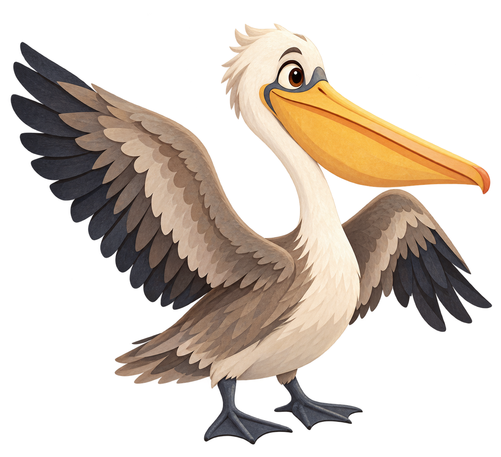
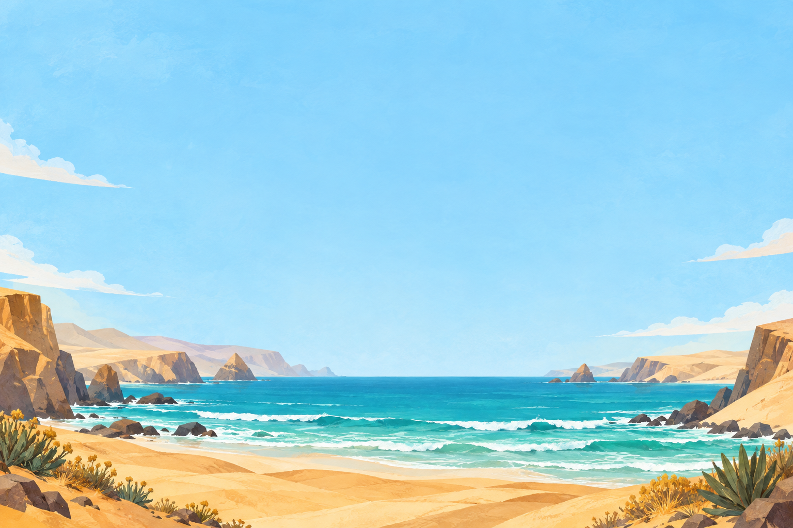
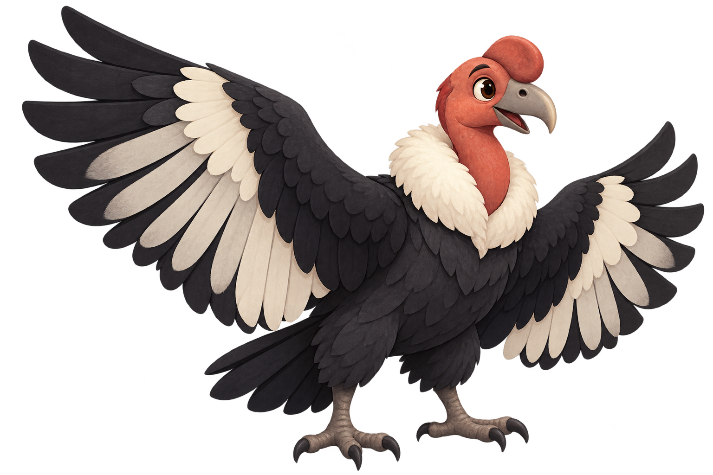
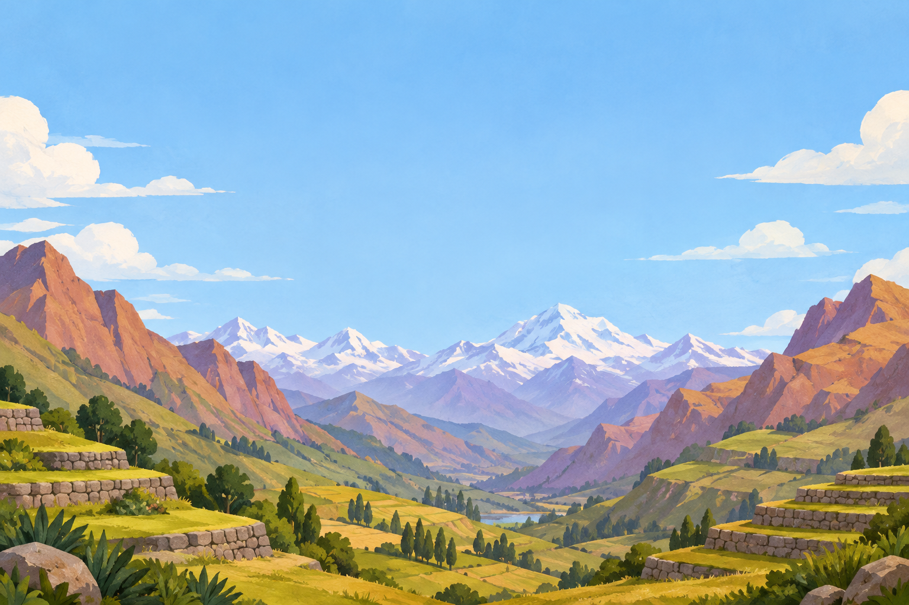
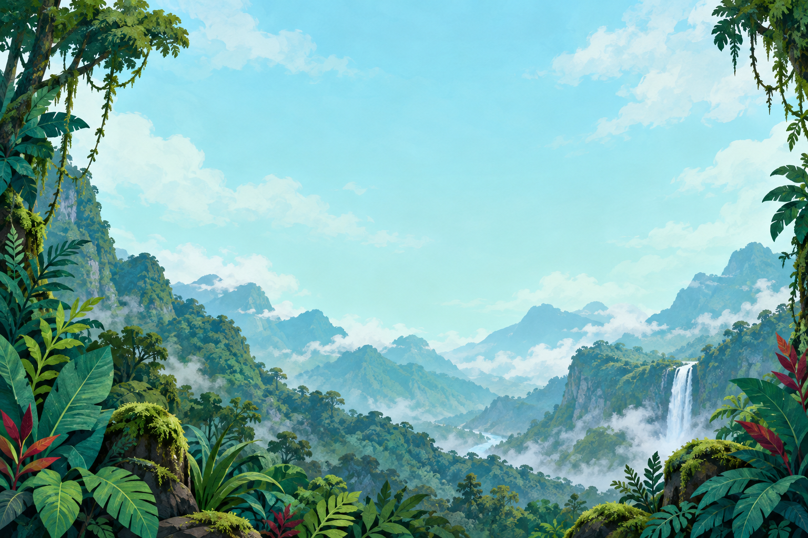
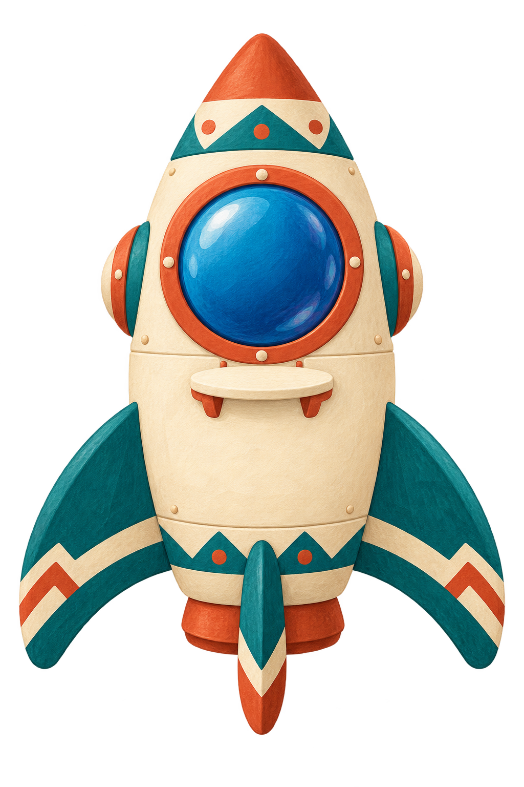
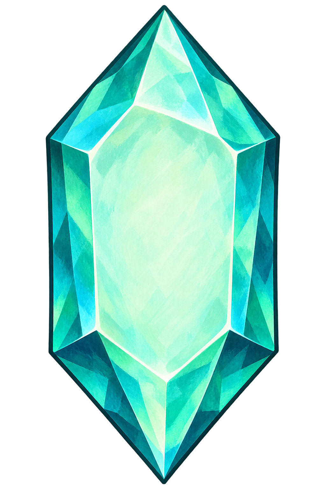
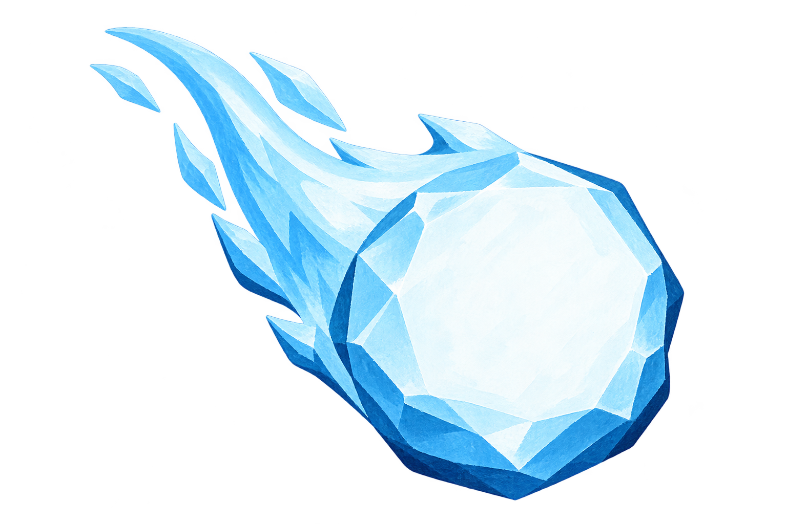

# Space Cargo assets

The current direction is [animated pixel art](pixel/README.md). The [review board](../../../../../docs/SPACE_CARGO_ASSETS.html) now plays that pack. The static painted assets below are preserved as superseded source variants.

Nine static PNG assets created with the built-in `image_gen` tool for the requested Peruvian multiplication game. This is an asset pack, not a playable game or animation sheet.

| Region | Companion | Background |
| --- | --- | --- |
| Coast |  |  |
| Highlands |  |  |
| Jungle |  |  |

| Shared spacecraft | Energy group collectible | Group-removal comet |
| --- | --- | --- |
|  |  |  |

See [manifest.json](manifest.json) for the exact final prompts, filenames, texture roles, region mapping and generation provenance. See [verification.json](verification.json) for dimensions, byte counts, SHA-256 checksums and alpha-channel checks. Discarded photographic character variants are not included.

All six foreground assets contain actual transparency. Backgrounds are 1536 × 1024. Preserve aspect ratios when displaying sprites; the foreground dimensions differ. These are source-resolution PNGs (approximately 17.4 MB for the whole pack); prepare optimized delivery variants before integrating into the playable route and load only the selected region. Generated artwork is fictional and is not a biological illustration or a claim of reviewed cultural representation.

Draw all numbers, dot groups, operation signs, score and localized instructions at runtime. The intentionally blank spacecraft/crystal/comet surfaces support this. Match hit areas to visible objects rather than transparent image bounds. Use a high-contrast text backing where scenery interferes with readability. Keep the bird secondary to the equal-group representation.

The [design specification](../../../../../docs/SPACE_CARGO_DESIGN.md) records the minimal teacher form, confirmed multiplication mechanic, proposed score/ranking rules and provider-independent LLM workflow. The [review board](../../../../../docs/SPACE_CARGO_ASSETS.html) composites the actual transparent sprites over all three backgrounds for visual inspection. It is a static design artifact with English annotations, not product UI.
